# ADB Wi-Fi Connector RU 3.0

> [!CAUTION]
> **Бета-версия.** Возможны ошибки и нестабильная работа. Функциональность и дальнейшая разработка могут измениться или быть приостановлены. Используйте на свой риск.

Русская программа для Windows, которая подключается к Android-телефону по Wi-Fi и позволяет управлять им с компьютера: файлы и приложения, экран и управление, терминал adb. Root не нужен — используется официальный adb. Без рекламы и пробного периода.

## Скачать

**[ADB_WiFi_Connector_v3.0.exe](https://github.com/flash72i/ADB_WiFi_Connector_v3.0/releases/latest/download/ADB_WiFi_Connector_v3.0.exe)** — Windows 10/11 x64, 128 МБ.

Установщик предлагает два режима: установить программу в систему или распаковать portable-версию в выбранную папку.

## Программа

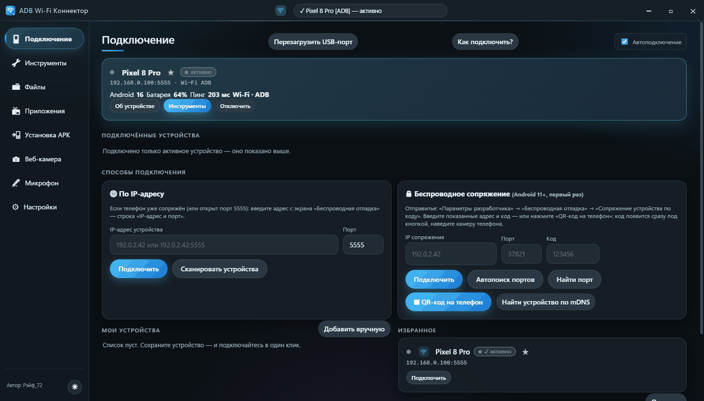

Подключение → Инструменты → Файлы → Приложения → Установка APK → Веб-камера → Микрофон → Настройки. Смена кадра каждые 2 секунды.

Отдельные скриншоты

<table>
  <tr>
    <td width="50%">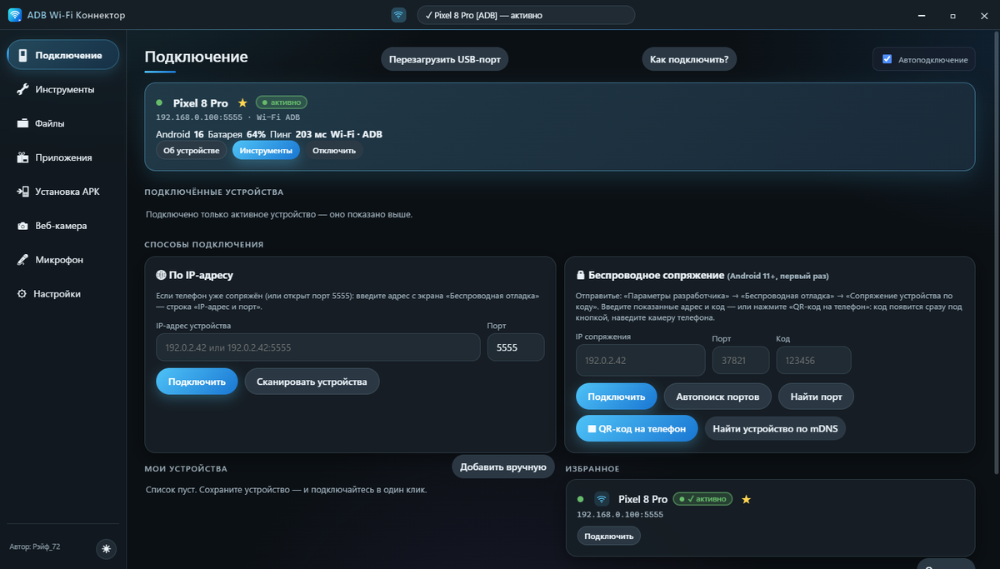</td>
    <td width="50%">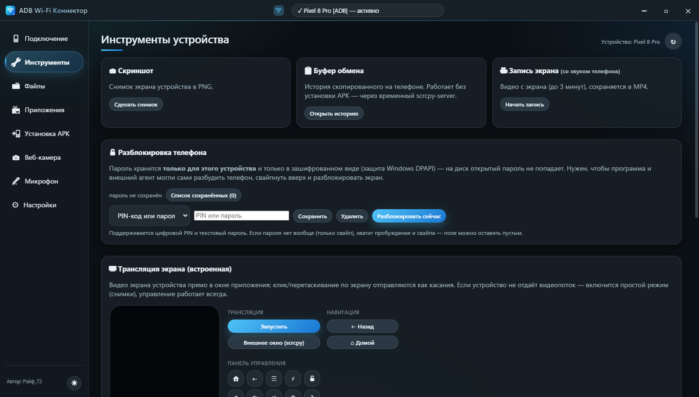</td>
  </tr>
  <tr>
    <td align="center">Подключение</td>
    <td align="center">Инструменты</td>
  </tr>
  <tr>
    <td width="50%">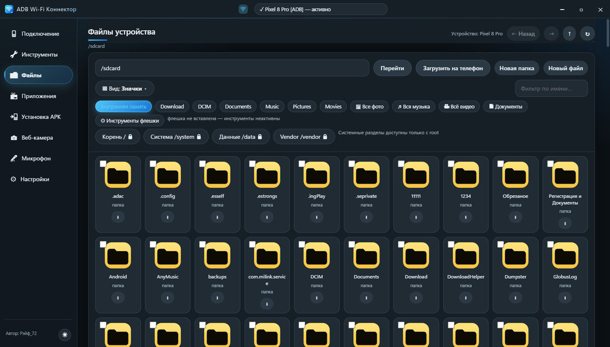</td>
    <td width="50%">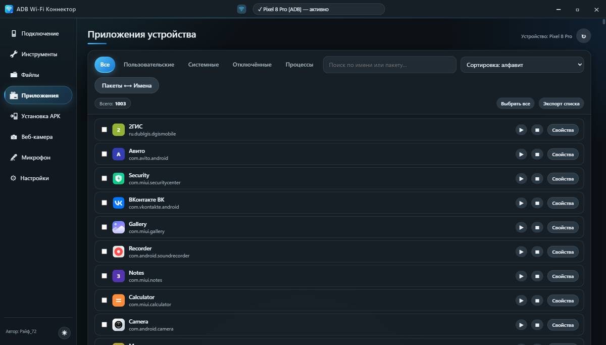</td>
  </tr>
  <tr>
    <td align="center">Файлы</td>
    <td align="center">Приложения</td>
  </tr>
  <tr>
    <td width="50%">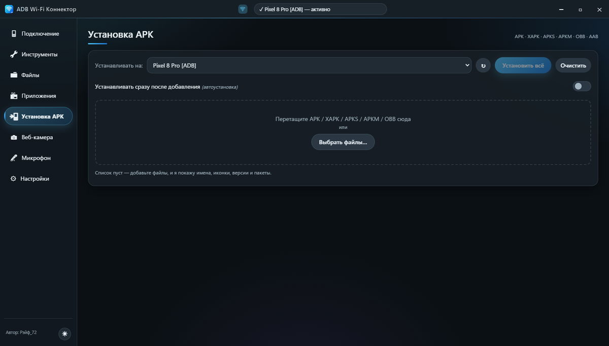</td>
    <td width="50%">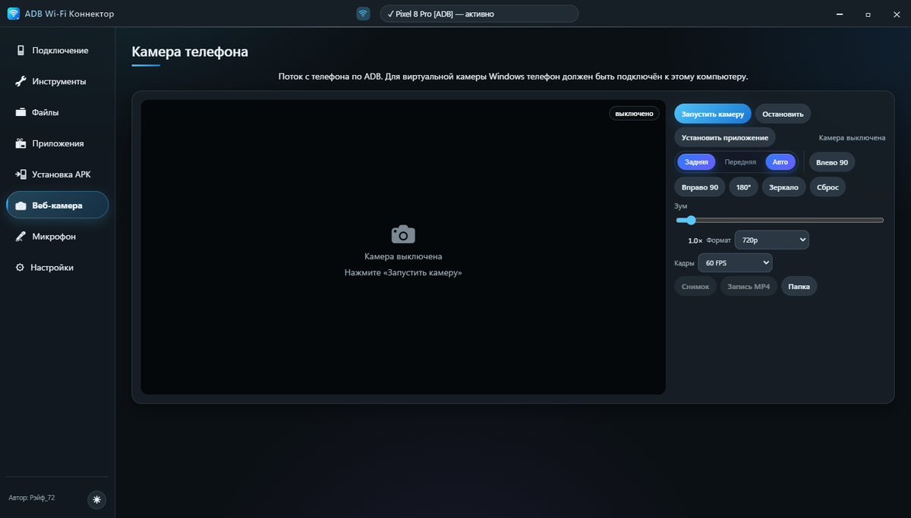</td>
  </tr>
  <tr>
    <td align="center">Установка APK</td>
    <td align="center">Веб-камера</td>
  </tr>
  <tr>
    <td width="50%">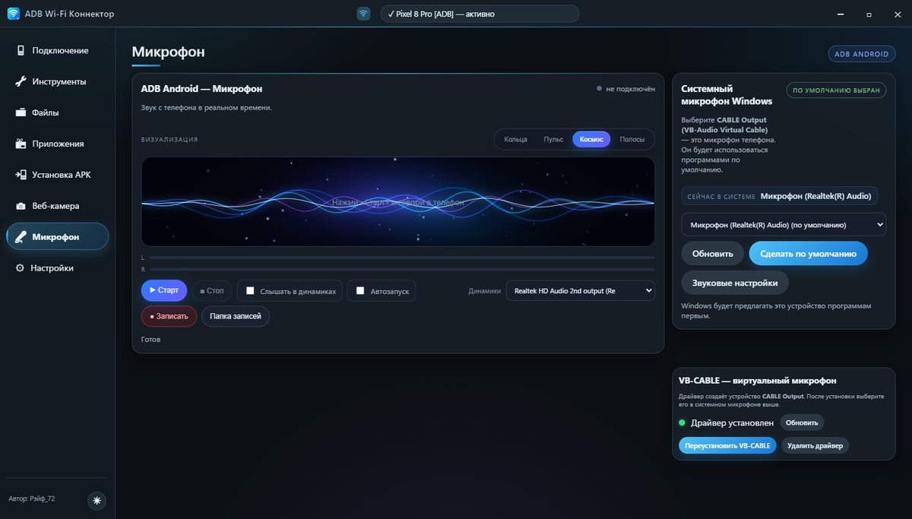</td>
    <td width="50%">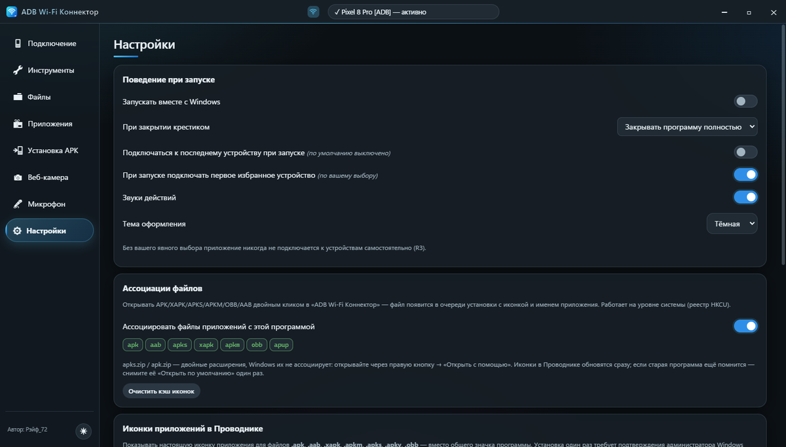</td>
  </tr>
  <tr>
    <td align="center">Микрофон</td>
    <td align="center">Настройки</td>
  </tr>
</table>

## Что умеет

- Подключение по Wi-Fi: QR-код, IP:порт, mDNS; история и избранное устройств.
- Файлы телефона: просмотр, скачивание и загрузка, переименование, удаление, ZIP-архивы, просмотр DOCX и контактов VCF, работа с USB/OTG-флешками.
- Приложения: список, установка APK, запуск и остановка, очистка данных и кэша.
- Экран и управление: scrcpy, скриншоты, запись видео, буфер обмена.
- Веб-камера и микрофон телефона на компьютере через ADB.
- Терминал adb и MCP-сервер для ИИ-агентов.
- Иконки APK в Проводнике Windows.

## Установщик

<table>
  <tr>
    <td width="50%">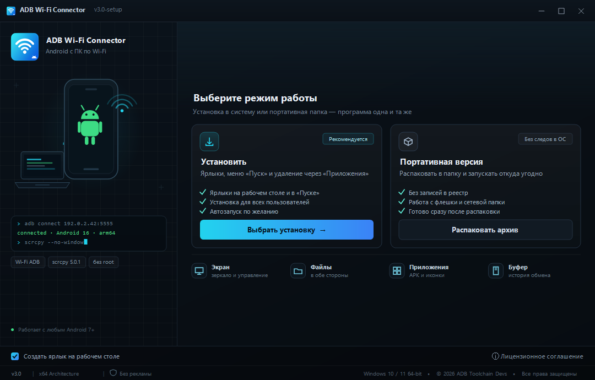</td>
    <td width="50%">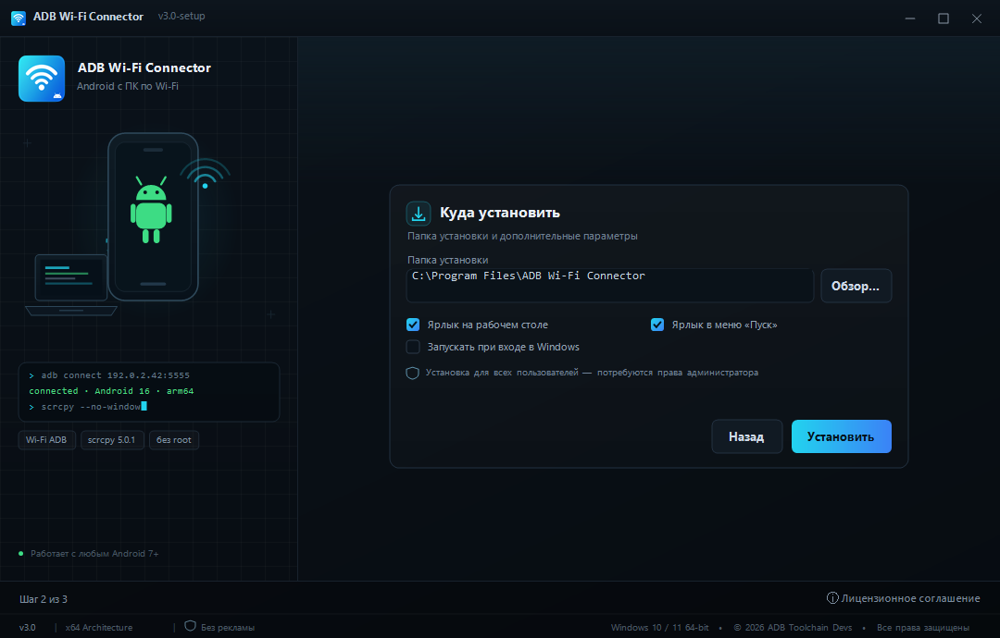</td>
  </tr>
  <tr>
    <td align="center">Выбор режима: установка или portable</td>
    <td align="center">Параметры установки</td>
  </tr>
  <tr>
    <td width="50%">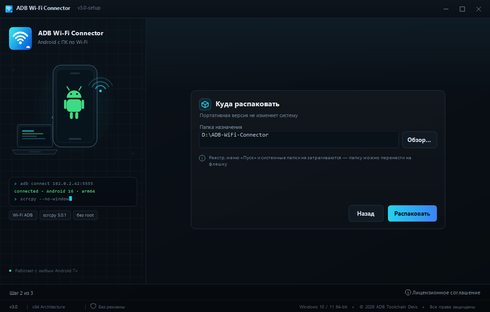</td>
    <td width="50%">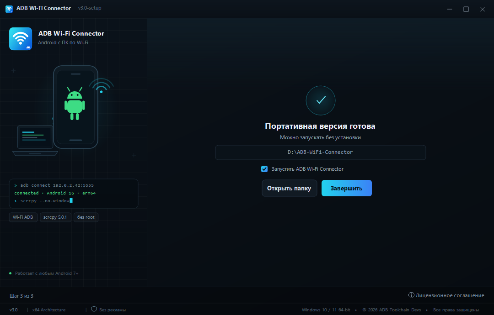</td>
  </tr>
  <tr>
    <td align="center">Параметры portable-версии</td>
    <td align="center">Portable-версия готова</td>
  </tr>
</table>

## Как подключить

1. На телефоне: «Для разработчиков» → «Беспроводная отладка».
2. Телефон и компьютер — в одной сети Wi-Fi; сеть Windows должна быть «Частной».
3. В программе: «QR-код на телефон» или ввести IP:порт с экрана отладки. При первом подключении телефон попросит сопряжение.

## Состав репозитория

- `main.js`, `adb.js`, `mdns.js`, `preload.js`, `qrpair.js` — основная логика приложения (Electron).
- `renderer/` — интерфейс: HTML, CSS, JS.
- `camera/` — камера и микрофон: Python-серверы, C++ исходники виртуальной камеры, Android-приложение и драйвер VB-CABLE.
- `installer/src/` — установщик на C#/WinForms.
- `shellext/` — расширение Проводника Windows.
- `tools/` — лаунчер и служебные скрипты.
- `installer/preview/`, `docs/screenshots/` — скриншоты.
- `README-BUILD.md`, `AGENTS.md` — сборка и правила проекта.

## Сборка

Кратко: Electron 33, официальный adb и scrcpy. Установщик собирается из `installer/src` компилятором C# (`csc.exe`). Подробности — в `README-BUILD.md` и `AGENTS.md`.

## Лицензия

Код этой сборки — MIT. adb — Android SDK Platform-Tools (© Google), scrcpy — Apache-2.0. VB-CABLE — сторонний подписанный драйвер, условия — в `camera/drivers/VBCABLE/readme.txt`. Лицензии сторонних компонентов лежат в `shellext/` и описаны в `README-BUILD.md`.
